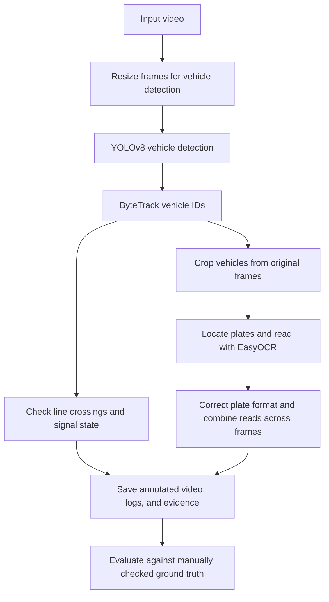

# Indian ANPR and Traffic Violation Detection

A Python project that detects vehicles in traffic video, tracks their movement, reads Indian number plates, and flags traffic violations. ANPR stands for **Automatic Number Plate Recognition**.

The system supports **red-light crossing, over-speeding, and wrong-way driving**. It saves an annotated video, vehicle records, violation logs, and evidence images. A separate evaluation script generates accuracy reports from manually checked ground truth.

## Project objectives

| Requirement | Implementation |
|---|---|
| Detect vehicles | YOLOv8 detects cars, motorcycles, buses, and trucks. |
| Track vehicles | ByteTrack assigns IDs across video frames. |
| Read number plates | A trained YOLOv8 plate detector locates plates; EasyOCR reads the text. |
| Improve plate readings | Indian plate-format correction and voting across frames combine repeated reads. |
| Detect violations | Configurable road lines and signal states define the rules. |
| Save evidence | Annotated video, CSV logs, violation snapshots, and plate crops. |
| Measure accuracy | Compare predictions with labelled plates and violations using `evaluate.py`. |

**Technology:** Python, OpenCV, Ultralytics YOLOv8, ByteTrack, EasyOCR, NumPy, Pandas, and PyYAML.

## Project flow



Vehicle detection uses resized frames to reduce processing cost. By default, plate crops come from the original frames to preserve text detail. If the plate model is unavailable, EasyOCR text detection is used inside each vehicle crop.

The rule engine uses the bottom-center of each vehicle box to check line crossings:

| Violation | Trigger |
|---|---|
| `RED_LIGHT` | A vehicle crosses the stop line while the configured signal is red. |
| `OVERSPEED` | Speed between lines A and B exceeds `limit_kmph`. |
| `WRONG_WAY` | A vehicle crosses line B before line A. The permitted order is A, then B. |

Speed is calculated as `distance_m / elapsed_seconds × 3.6`. A violation can be recorded even when its number plate is unreadable.

## Requirements

- Python 3 with `pip` and virtual environment support.
- Dependencies listed in [requirements.txt](requirements.txt).
- A traffic video with visible vehicles and readable plates.
- Internet access for dependency installation and initial vehicle/OCR model downloads.
- A CPU to run the project. GPU acceleration is optional and requires a compatible PyTorch installation.

The trained plate model is included at `weights/plate_yolov8n.pt`. Original input videos, training datasets, and generated output folders are excluded from Git.

## Installation

```bash
git clone https://github.com/ManojLamani/Indian-ANPR-Violation-Detection.git
cd Indian-ANPR-Violation-Detection
python -m venv .venv
```

Activate the environment on Windows PowerShell:

```powershell
.\.venv\Scripts\Activate.ps1
```

Or on Linux/macOS:

```bash
source .venv/bin/activate
```

Install dependencies:

```bash
python -m pip install -r requirements.txt
```

Run the following commands from the repository root.

## Run on your own video

### 1. Add a video

Save your video as `data/traffic.mp4`, or set its path under `video.source` in [config.yaml](config.yaml). Use a fixed camera view for meaningful line-crossing measurements.

### 2. Mark the road lines

```bash
python tools/pick_points.py --video data/traffic.mp4
```

Click two points for each line in this order: **stop line**, **line A**, then **line B**. For automatic signal detection, also select the top-left and bottom-right corners of the traffic-light region.

Press **S** or **Enter** to print coordinates, **U** to undo, and **Q** to close. Copy the values into `config.yaml`:

- `stop_line` goes under `rules.red_light`.
- `line_a` and `line_b` go under `rules.speed`.
- `light_roi` goes under `rules.red_light.signal`.

Coordinates are normalized between `0` and `1` relative to frame width and height.

### 3. Configure the rules

The default coordinates and signal times are examples. Update them for your video before interpreting results.

| Setting | What to configure |
|---|---|
| `rules.red_light.enabled` | Enable or disable red-light detection. |
| `rules.red_light.signal.mode` | `manual` for known red intervals, `timed` for a fixed red/green cycle, or `auto` for lamp-color detection. |
| `rules.red_light.signal.red_intervals` | Red intervals in video seconds for manual mode, such as `[[0, 8], [20, 30]]`. |
| `rules.speed.enabled` | Enable or disable over-speed detection. |
| `rules.speed.distance_m` | Measured road distance between lines A and B, in meters. |
| `rules.speed.limit_kmph` | Speed threshold for the video. |
| `rules.wrong_way.enabled` | Enable detection of travel from B to A. This rule also uses the lines under `rules.speed`. |

### 4. Process the video

```bash
python main.py --config config.yaml
```

Useful options:

```bash
# Show a preview; press Q to stop.
python main.py --display

# Process a short sample into a separate output folder.
python main.py --source data/traffic.mp4 --max-frames 300 --out-dir outputs/sample

# Use EasyOCR plate localization instead of the trained plate model.
python main.py --plate-model none --out-dir outputs/ocr_baseline
```

Use a different `--out-dir` for each experiment to keep its logs and images together. It also redirects the annotated video unless `--output` is supplied separately.

### 5. Review the results

| Default output | Contents |
|---|---|
| `outputs/annotated.mp4` | Vehicle boxes, track IDs, plates, speed estimates, and violation alerts. |
| `outputs/vehicles.csv` | One record per tracked vehicle, including plate confidence, speed, and violations. |
| `outputs/violations.csv` | One record per violation, including type, track ID, time, plate, and snapshot path. |
| `outputs/violations/` | Violation snapshots when snapshot saving is enabled. |
| `outputs/plates/` | Plate crops when suitable crops are available and saving is enabled. |
| `outputs/run_summary.json` | Frame count, processing speed, vehicle counts, and violation totals. |

## Included demonstrations

Review the saved results without running the pipeline:

- **Mumbai:** [violation video](demo/mumbai_violations_demo.mp4), [CSV log](demo/mumbai_violations.csv), and [accuracy report](demo/mumbai_accuracy_report.md).
- **Bhopal:** [plate recognition video](demo/bhopal_plates_demo.mp4) and [accuracy report](demo/bhopal_accuracy_report.md).
- **Documentation:** [project report](REPORT.md) covering design, training, results, and error analysis.

To reproduce the runs, supply the original clips at `data/mumbai_4k.mp4` and `data/bhopal_4k.mp4`, then run:

```bash
python main.py --config configs/mumbai.yaml
python main.py --config configs/bhopal.yaml
```

The Mumbai configuration enables red-light and speed checks. The Bhopal configuration measures plate recognition with violation rules disabled because the camera moves.

For a basic setup check without your own traffic footage:

```bash
python tools/make_synthetic_video.py --out data/synthetic.mp4
python main.py --source data/synthetic.mp4 --out-dir outputs/synthetic
```

The synthetic clip checks pipeline operation. Use labelled real footage to measure accuracy.

## Evaluate accuracy

After processing a video, copy `data/ground_truth_template.csv` to `data/ground_truth.csv` and replace the sample rows with manually verified plates and violations. Leave `violation` blank for vehicles without violations. Use `RED_LIGHT`, `OVERSPEED`, or `WRONG_WAY`; separate multiple labels with semicolons.

An optional `track_id` column can identify vehicles from the annotated video, allowing violation matching even when OCR fails.

```bash
python evaluate.py --gt data/ground_truth.csv --outputs outputs

# Evaluate the Mumbai run with its included ground truth.
python evaluate.py --gt data/ground_truth_mumbai.csv --outputs outputs/mumbai
```

Evaluation saves `accuracy_report.md` and `accuracy_report.json` in the selected output folder. Reports include plate exact-match recall, character accuracy, plate precision, and violation precision, recall, and F1. Detector metrics are included from `weights/plate_metrics.json` when available.

### Recorded results

These results come from the included reports. Detector scores measure locating plates; OCR scores measure reading their text.

| Evaluation | Recorded result |
|---|---|
| Plate detector: held-out test split | 96.6% precision, 85.7% recall, 93.2% mAP@0.5. |
| Mumbai: plate recognition | 3 of 12 labelled plates read exactly; 64.2% character accuracy. |
| Mumbai: red-light detection | 3 of 3 checked violations detected, with no false positives in this clip. |
| Bhopal: plate recognition | 2 of 3 labelled plates read exactly; 93.3% character accuracy. |
| Mumbai: CPU processing | Approximately 1.8 FPS for the recorded run with 4K source footage. |

The video samples are small. They do not establish accuracy across other roads, cameras, lighting conditions, or violation types.

## Train the plate detector

Training is optional because trained weights are included. Prepare a dataset with one class, `license_plate`, and a YOLO `data.yaml` file.

Conversion tools support COCO splits containing images and `_annotations.coco.json`, or Pascal VOC datasets containing `images/` and `annotations/`:

```bash
python tools/convert_coco_to_yolo.py --src datasets/hf_raw --dst datasets/plates
# Or, for Pascal VOC input:
python tools/convert_voc_to_yolo.py --src datasets/voc_raw --dst datasets/plates
```

To use the CPU training settings recorded in the project report:

```bash
python train_plate_detector.py --data datasets/plates/data.yaml --epochs 20 --imgsz 416 --fraction 0.5 --device cpu
```

The script saves the best model to `weights/plate_yolov8n.pt` and metrics to `weights/plate_metrics.json`. It evaluates the test split when present, otherwise the validation split. Set `models.plate_imgsz` in the run configuration to the image size used for training.

Resume an interrupted run when `runs/plate/train/weights/last.pt` exists:

```bash
python train_plate_detector.py --data datasets/plates/data.yaml --resume
```

See [REPORT.md](REPORT.md) for the included model's dataset and training details.

## Project structure

```text
anpr/                     Plate detection, OCR, tracking state, rules, and drawing
configs/                  Mumbai and Bhopal run configurations
data/                     Ground-truth CSV files and local input videos
demo/                     Saved videos, evidence, and accuracy reports
tests/                    Unit tests for core processing logic
tools/                    Line selection, synthetic video, and dataset conversion
weights/                  Trained plate detector and recorded detector metrics
config.yaml               Default video, model, OCR, rule, and output settings
main.py                   Vehicle detection, tracking, and video processing pipeline
evaluate.py               Accuracy evaluation and report generation
train_plate_detector.py   Plate detector training and evaluation
requirements.txt          Python dependencies
REPORT.md                 Detailed project report
```

## Tests

```bash
python -m unittest discover tests -v
```

The tests cover plate-text correction and voting, deskewing, line geometry, signal states, violation rules, and edit-distance calculation.

## Limitations

- Small plates, motion blur, glare, unusual fonts, and poor lighting reduce OCR accuracy.
- Tracking IDs can change during occlusion or dense traffic.
- Line-crossing rules depend on camera stability and correct line placement.
- Speed estimates depend on the measured distance and video timing.
- Automatic signal detection requires a visible lamp in a correctly configured region.
- Indian format correction targets common state/district registration patterns. Other plate formats may require changes; `ocr.format: none` disables Indian format correction.
- Processing speed depends on resolution, scene complexity, and hardware. The recorded CPU runs are slower than real time.
